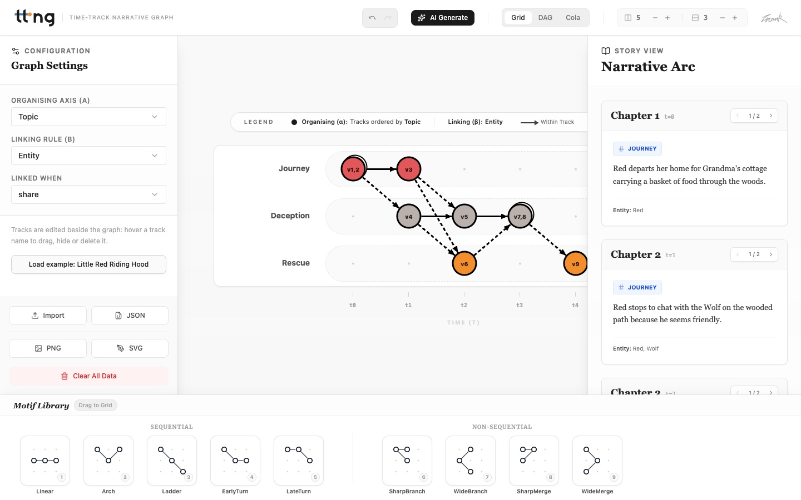

<h1 align="center">
  <a href="https://narrative-graph.songhai.site">
    <picture>
      <source media="(prefers-color-scheme: dark)" srcset=".github/brand/lockup-dark.svg" />
      
    </picture>
  </a>
</h1>

<p align="center"><b>Time Track Narrative Graph</b></p>

<p align="center">
  <a href="https://narrative-graph.songhai.site">Live editor</a> ·
  <a href="#running-the-pieces-today">Run it</a> ·
  <a href="python/README.md">Python engine</a> ·
  <a href="docs/THESIS.md">Thesis notes</a> ·
  <a href="README.zh-CN.md">中文</a>
</p>



Design a story as a graph, then let an LLM write it. ttng stands for Time Track Narrative Graph: a narrative laid out on a time-by-track grid. The repository is called `narrative-graph`.

A narrative is laid out on a **time × track grid**, where tracks are topics or entities. Nodes are story beats, edges connect beats that share an attribute, and nine reusable **motifs** (Linear, Arch, Ladder, EarlyTurn, LateTurn, SharpBranch, WideBranch, SharpMerge, WideMerge) describe how a plot moves between tracks.

> **Status: early.** Three earlier projects were merged here with their git history intact and are being joined step by step ([docs/REFACTOR.md](docs/REFACTOR.md)). The editor's JSON file goes through the Python writer and back (`python -m ttng_story`); there is no button for it yet, and the writer has never been run against the live OpenAI API. See [docs/MIGRATION.md](docs/MIGRATION.md) for what came from where.

## Layout

| Path | What it is | Came from |
|---|---|---|
| [apps/web](apps/web) | Graph editor: drag motifs onto the grid, DAG and force views, undo/redo, AI graph generation through OpenRouter (React 19, Vite, Cytoscape) | `ttng-constructor` |
| [python](python) | Generation engine: narrative structure → aligned themes, entities and time periods → LLM writes one chapter per node | `gpt_storytale` |
| [legacy/gpt_storyteller](legacy/gpt_storyteller) | Earlier pipeline. Kept only to lift cartographer, journalist and graph code into `python/`, then to be deleted | `gpt_storyteller` |
| [schema](schema) | The graph, graph-file and story JSON Schemas, with the fixtures both test suites read | – |
| [examples](examples) | A finished sample: Little Red Riding Hood, nine chapters on three tracks (load it from the editor's left panel) | – |
| [docs](docs) | Notes, including [how the code maps to the thesis](docs/THESIS.md) | – |

## Running the pieces today

Web editor:

```bash
cd apps/web
npm install
npm run dev    # the AI dialog asks for your own OpenRouter key; none is needed to edit
```

Python engine: see [python/README.md](python/README.md).

## License

[MIT](LICENSE). The repository was called `gpt_storytale` until it was renamed to `SonghaiFan/narrative-graph`; the old address redirects.

<br />

<p align="center">
  <a href="https://syuze.songhai.site"></a>&nbsp;
  <a href="https://news-metro.songhai.site"></a>&nbsp;
  <a href="https://narrative-graph.songhai.site"></a>&nbsp;
  <a href="https://visdelta.songhai.site"></a>&nbsp;
  <a href="https://cytocausal.songhai.site"></a>&nbsp;
  <a href="https://aethel.songhai.site"></a>
</p>

<p align="center"><sub>ttng is part of the Frank series.</sub></p>

<p align="right">
  <picture>
    <source media="(prefers-color-scheme: dark)" srcset=".github/brand/frank-signature-dark.svg" />
    
  </picture>
</p>
