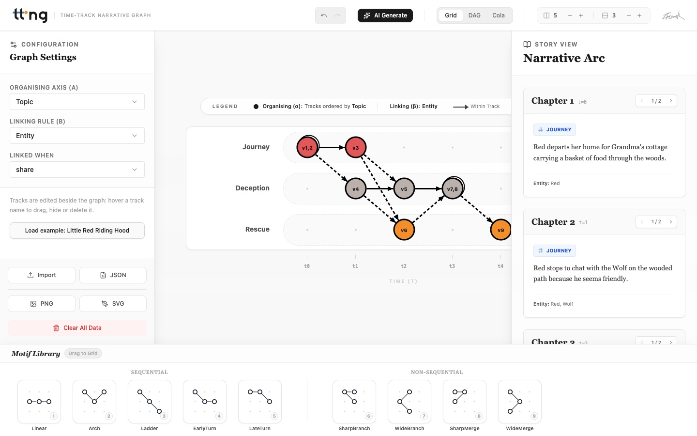

<h1 align="center">
  <a href="https://narrative-graph.songhai.site">
    <picture>
      <source media="(prefers-color-scheme: dark)" srcset=".github/brand/lockup-dark.svg" />
      
    </picture>
  </a>
</h1>

<p align="center"><b>Time Track Narrative Graph · 时间–轨道叙事图</b></p>

<p align="center">
  <a href="https://narrative-graph.songhai.site">在线编辑器</a> ·
  <a href="#现在怎么运行">运行</a> ·
  <a href="python/README.md">Python 引擎</a> ·
  <a href="docs/THESIS.md">论文对照</a> ·
  <a href="README.md">English</a>
</p>



先把故事设计成一张图，再让大语言模型把它写出来。ttng 是 Time Track Narrative Graph 的缩写：把叙事排布在“时间 × 轨道”的网格上。仓库名是 `narrative-graph`。

叙事排布在 **时间 × 轨道网格** 上，轨道是话题或实体。节点是故事节拍，边连接共享某个属性的节拍；九种可复用的 **母题（motif）**（Linear、Arch、Ladder、EarlyTurn、LateTurn、SharpBranch、WideBranch、SharpMerge、WideMerge）描述情节如何在轨道之间移动。

> **状态：早期。** 三个更早的项目连同 git 历史一起合并到了这里，正在一步步整合（[docs/REFACTOR.md](docs/REFACTOR.md)）。编辑器导出的 JSON 可以交给 Python 写作器处理再导回（`python -m ttng_story`）；目前还没有对应的按钮，写作器也还没有接真实的 OpenAI API 跑过。各部分的来源见 [docs/MIGRATION.md](docs/MIGRATION.md)。

## 目录结构

| 路径 | 内容 | 来源 |
|---|---|---|
| [apps/web](apps/web) | 图编辑器：把母题拖到网格上，DAG 和力导向视图，撤销/重做，通过 OpenRouter 用 AI 生成图（React 19、Vite、Cytoscape） | `ttng-constructor` |
| [python](python) | 生成引擎：叙事结构 → 对齐的主题、实体和时间段 → 大语言模型为每个节点写一章 | `gpt_storytale` |
| [legacy/gpt_storyteller](legacy/gpt_storyteller) | 更早的流水线。只为把 cartographer、journalist 和图相关代码迁到 `python/` 而保留，之后会删除 | `gpt_storyteller` |
| [schema](schema) | 图、图文件和故事的 JSON Schema，以及两套测试共用的测试数据 | – |
| [examples](examples) | 一个完成的示例：小红帽，三条轨道上的九章（可在编辑器左侧面板加载） | – |
| [docs](docs) | 笔记，包括[代码与论文的对应关系](docs/THESIS.md) | – |

## 现在怎么运行

网页编辑器：

```bash
cd apps/web
npm install
npm run dev    # AI 对话框会要求填入你自己的 OpenRouter key；只做编辑不需要
```

Python 引擎：见 [python/README.md](python/README.md)。

## 许可

[MIT](LICENSE)。仓库在改名为 `SonghaiFan/narrative-graph` 之前叫 `gpt_storytale`；旧地址会自动跳转。

<br />

<!-- series-footer:start -->

<p align="center">
<a href="https://syuze.songhai.site"></a>&nbsp;
  <a href="https://news-metro.songhai.site"></a>&nbsp;
  <a href="https://narrative-graph.songhai.site"></a>&nbsp;
  <a href="https://visdelta.songhai.site"></a>&nbsp;
  <a href="https://cytocausal.songhai.site"></a>&nbsp;
  <a href="https://aethel.songhai.site"></a>
</p>

<p align="center"><a href="https://github.com/SonghaiFan/perspectiva">Perspectiva</a> · <a href="https://github.com/SonghaiFan/access">Access</a></p>

<p align="center"><sub>Frank series · Made by <a href="https://github.com/SonghaiFan">Songhai Fan</a></sub></p>

<!-- series-footer:end -->

<p align="right">
  <picture>
    <source media="(prefers-color-scheme: dark)" srcset=".github/brand/frank-signature-dark.svg" />
    
  </picture>
</p>
