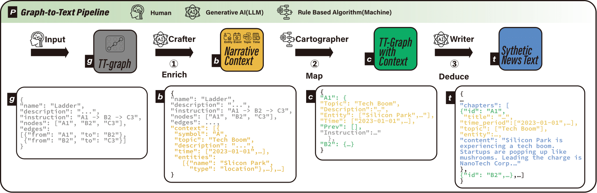

# GPT Storytale

Generate controllable synthetic news stories for user-evaluation studies of text-to-visualisation pipelines.

You describe the *shape* of a story as a small graph (for example `A1 -> B2 -> A3`, where letters are themes and digits are the chapter order). The engine assigns themes, entities and time periods to each node, then asks an LLM to write one short news chapter per node, each continuing from the chapters it connects to.



| Step in the figure | What it does | Where it lives |
|---|---|---|
| ① Crafter (LLM) | Enriches a bare graph with themes, entities and time ranges | Not in this directory. Its output is [meta/narrative_context_*.json](meta) |
| ② Cartographer (rules) | Picks entities and time slices for every node | [narrative_alignmenter.py](narrative_alignmenter.py) |
| ③ Writer (LLM) | Writes each chapter from its aligned context and its parents' text | [narrative_deducer.py](narrative_deducer.py) |

[storytale.py](storytale.py) runs ② and ③ for every structure in a context file and saves the results.

## Setup

```bash
cd python
python3 -m venv .venv
source .venv/bin/activate        # fish: source .venv/bin/activate.fish
pip install -r requirements.txt
cp .env-template .env            # then put your key after OPENAI_API_KEY=
```

The versions in `requirements.txt` are pinned to the ones the code was checked with. LangChain is down to `langchain-core`, used only to build the JSON format instructions in the prompt; the model is called through the `openai` SDK.

`.env` is git-ignored. Do not commit it.

## Run

Run everything from this `python/` directory, because all paths are relative.

```bash
python storytale.py
```

This reads `meta/narrative_context_a.json` and generates one story for each of its nine structures under the label `Set_A2` (hard-coded at the bottom of `storytale.py`). That is **27 `gpt-4` calls**, one per chapter, at temperature 0.5. Each structure gets a random seed from 0 to 1000.

It prints nothing to the console: `storytale.py` redirects stdout into the log file. The log fills in as it goes, but it is buffered, so it can lag behind.

Outputs, named `{label}_{structure}_seed{N}.json`:

| Folder | File | Contents |
|---|---|---|
| `alignment/` | `alignment_…json` | Themes, entities, time slices and parents per node |
| `stories/` | `story_…json` | The generated chapters |
| `logs/` | `log_…json` | Plain text, despite the extension: every prompt sent and every chapter received |

To generate one structure with a seed you choose:

```python
import json, storytale

storytale.narrative_context = json.load(open("meta/narrative_context_a.json"))
storytale.generate_story_files("Set_A2", "Arch", seed=42)
```

The seed fixes which entities are sampled. It does not make the LLM output repeatable. The label is only used in file names; themes come from the context file.

To rewrite `story.json` from the sample `alignment_results.json` (Arch, three chapters), run `python narrative_deducer.py`. This overwrites the committed `story.json`.

## Write a graph from the editor

```bash
python -m ttng_story narrative_graph.json --period 2024-01-01 2024-12-31 -o with_text.json
```

Takes the file the editor's JSON button downloads, writes one chapter per node (one model call each) and saves the same file with each node's `content` filled in. The editor's Import button reads it and the story sidebar shows the text. `--period` gives the nodes their dates, since the editor's own "Time Period" values are free text; `--context` and `--structure` can be used instead, as below. Chapters are matched to nodes by position, not by the `id` in the model's reply. This calls the OpenAI API with the key from `.env`.

## Align a graph from the editor

`ttng_align.py` does step ② for a graph instead of a context file. Nodes keep the entities they carry; a node without any is sampled from its topic's pool in a context file.

```bash
python -m ttng_align graph.json --context meta/narrative_context_a.json --structure Arch --seed 42 -o alignment.json
```

The output has the shape of `alignment_results.json`, so `narrative_deducer.create_story` accepts it. Each node needs exactly one `Topic`. Its dates come from a `Time Period` attribute holding two ISO dates, or else from slicing the topic's range in the context, or else from `--period START END`. Parents are the graph's `edges`, or else the editor's edge rule (which only works when the nodes already carry entities). In Python, `ttng_align.graph_from_structure(structure)` turns an old-style structure into such a graph. Nothing calls this from `storytale.py` yet.

## Tests

```bash
pip install -r requirements-dev.txt
python -m pytest
```

The tests never reach the network. Sockets and DNS are blocked, the writer runs against a fake client, and one test sends the real request (the writer, `OpenAIClient` and the openai SDK) through a faked HTTP layer to check the endpoint, the model name (`gpt-4`), the temperature and the parent chapter's text. What they cover, and what they do not, is listed in [../docs/REFACTOR.md](../docs/REFACTOR.md).

## Data formats

A **context file** is a list of structures:

```json
{
  "name": "Arch",
  "description": "The narrative begins with Theme A, then shifts to Theme B, and finally returns to Theme A.",
  "structure": "A1 -> B2 -> A3",
  "nodes": ["A1", "B2", "A3"],
  "edges": [{"from": "A1", "to": "B2"}, {"from": "B2", "to": "A3"}],
  "context": [
    {"symbol": "A", "theme": "Economic Boom", "description": "…", "time": ["2023-01-01", "2023-12-31"],
     "entities": [{"name": "Mayor Lina", "type": "people"}]}
  ]
}
```

Entity types seen are `people`, `location` and `organisation`. A node id is its theme `symbol` plus a single digit, and the digit is its chapter number within the theme. The theme's time range is cut into roughly equal slices, one per chapter number.

The aligner turns that into one entry per node. Each node gets up to four entities sampled from its theme, plus one entity shared with a parent, so connected chapters have something in common:

```json
{"A1": {"Theme": "Economic Boom", "ThemeDescription": "…", "Entity": ["…"], "Time": ["2023-01-01", "2023-05-02"],
        "Prev": [], "StuctureInstruction": "…"}}
```

`StuctureInstruction` is misspelled in the code and in the data. Keep the spelling when reading or writing these files.

The writer returns `{"chapters": [{"id", "title", "time_period", "Topic", "entity", "content"}]}`, with each `content` around 100 words in plain English (the prompt asks for CEFR A1 and the style of a newspaper lead).

## Structures

`meta/narrative_context_a.json` holds nine structures, three chapters each:

| Structure | Edges | Name in the web editor |
|---|---|---|
| Linear | A1→A2→A3 | Linear |
| Arch | A1→B2→A3 | Arch |
| Ladder | A1→B2→C3 | Ladder |
| ShortFork | A1→B2→B3 | EarlyTurn |
| LongFork | A1→A2→B3 | LateTurn |
| WideBranch | B1→A2, B1→C2 | WideBranch |
| WideMerge | A1→B2, C1→B2 | WideMerge |
| SharpMerge | A1→B2, B1→B2 | SharpMerge (the web version merges into the first track, A, instead) |
| SharpBranch | A1→A2, A1→B2 | SharpBranch |

The other context files hold different sets: `_b` (2 structures), `_train` (5), `_full` (11, adds `Retain` and `Shift`) and `_c` (16). `_c` repeats several structure names, and the aligner uses the first match for a name.

## Files

| Path | Purpose |
|---|---|
| `storytale.py` | Entry point: align, write, save for each structure |
| `narrative_alignmenter.py` | Rule-based alignment (step ②) |
| `narrative_deducer.py` | LLM chapter writer (step ③) |
| `prompts/chapter.md` | The chapter prompt, with `{placeholders}` |
| `llm.py` | The client interface the writer calls, and `OpenAIClient` |
| `ttng_story.py` | Writes a graph's chapters into the editor's file; see above |
| `ttng_align.py` | Aligns a TTNG graph (the web editor's shape) into the same alignment the writer takes; see below |
| `ttng_edges.py` | The editor's edge rule in Python, tested against the same fixtures as the web version |
| `meta/types.py` | Pydantic models for chapters and stories (also `Node`, `Edge`, `Graph`, `Article` from the earlier pipeline) |
| `meta/narrative_context_*.json` | Structures with themes and entities |
| `story_packer.py` | Bundles story files; see the warning below |
| `alignment_results.json`, `story.json` | Sample input and output for `narrative_deducer.py` |
| `alignment/arc`, `stories/arc`, `logs/arc` | Results of earlier runs |

## Gotchas

- **`story_packer.py` moves files.** It runs as soon as it is imported. It writes `stories/combined_stories.json`, then *moves* every file in `stories/`, `logs/` and `alignment/` into an `arc/` subfolder of each. Run it only on a folder you can afford to reshuffle.
- **Don't run `narrative_alignmenter.py` directly.** Its `__main__` block uses `narrative_context`, which that file never loads, so it stops with a `NameError`. Use it through `storytale.py`.
- **The committed samples use an older schema.** 80 of the `story_*.json` files in `stories/arc` use the fields `event` and `topics`; the current writer produces `title` and `Topic`. The root `story.json` is the same older shape. Don't build on them without checking.
- **Node ids are one letter and one digit.** The aligner reads only the last character as the chapter number, so a chapter 10 or later would break.
- **Don't go back to a LangChain model wrapper.** `langchain.llms.OpenAI(model_name="gpt-4")` turned into langchain-community's `OpenAIChat`, which ignores the model name: it sent `gpt-3.5-turbo` plus a stray `model_name` field, and on openai 1.x or newer it fails on the first call. The community `ChatOpenAI` that replaced it is deprecated. The writer now takes any client with `complete(prompt, *, model, temperature)` (see `llm.py`), and `OpenAIClient` is the default.
- **The prompt is `prompts/chapter.md`.** Edit the text there. The `{...}` words are placeholders; the file has no other braces, so write a literal brace as `{{` and `}}`.

## What has been checked

On Python 3.13, with the versions in `requirements.txt` installed into a clean virtual environment (`pip check` is clean), the tests run with sockets blocked and the HTTP layer faked. The request that `OpenAIClient` and the openai SDK build is inspected: `POST /v1/chat/completions`, `model` `gpt-4`, temperature 0.5, no stray fields. Replies are parsed into chapters, each prompt carries its parent chapter's text, and `storytale.py` writes the alignment, story and log files for every structure. Before Stage 3 the same was checked once by hand against a stand-in server with the old `ChatOpenAI` code. **A real call to the OpenAI API is still untried**, so run one structure before launching a full run.

## License

Not chosen yet. An earlier version of this README claimed MIT, but no `LICENSE` file exists. See [../docs/MIGRATION.md](../docs/MIGRATION.md).
